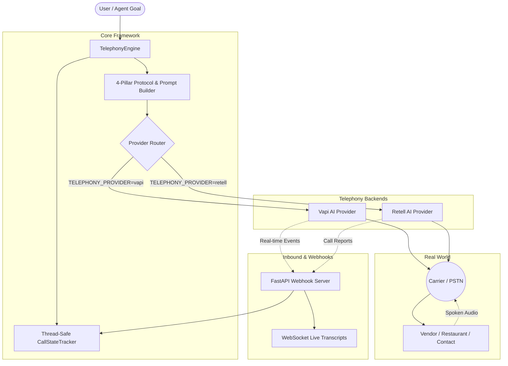

# 📞 Agentic Telephony

[](https://opensource.org/licenses/MIT)
[](https://www.python.org/)
[](https://vapi.ai)
[](https://crewai.com)

**Autonomous Human-Like AI Phone Calling & Receiving Agent Framework** powered by **Vapi AI** and **Retell AI**, featuring the **4-Pillar Human Transaction Protocol (AHTP)**.

Unlike typical robotic IVR bots or raw API wrappers, **Agentic Telephony** handles the messy, real-world conversational dynamics of real phone calls: conversational recovery after interruptions, strict pronoun fidelity, micro-math total validations, and complete logistical transaction closures.

---

## 🌟 Key Features

- **🔄 Dual-Engine Provider Architecture**: Seamlessly switch between **Vapi AI** and **Retell AI** via a single environment variable (`TELEPHONY_PROVIDER=vapi` or `TELEPHONY_PROVIDER=retell`).
- **🎙️ The 4-Pillar Human Transaction Protocol (AHTP)**:
  1. **Casual Opening & Interruption Recovery**: Opens with a natural *"Hi."* and never reboots into a 15-word script when interrupted.
  2. **Strict Pronoun Rule & Brevity**: Limits turns to 10–14 words, using pronouns (*"them"*, *"those"*, *"that"*) instead of repetitive descriptions.
  3. **Micro-Math & Reality Check**: Confirms pricing aloud (*"Cool, so about 30 bucks total"*) and verifies practical constraints (pickup hours, item holds, prep time).
  4. **360° Transaction Closure**: Directs SMS text confirmations to the Caller ID and validates logistical details before hanging up.
- **📥 Inbound Call Receiving & Webhooks**: Production-ready FastAPI/Starlette webhook receiver for live call events, conversation updates, and post-call AI summaries.
- **⚡ Live Transcript WebSocket Streaming**: Stream real-time turn-by-turn spoken audio transcripts directly to frontend dashboards or terminal HUDs.
- **🤖 Autonomous Multi-Agent Tooling**: Drop-in compatible tools for **CrewAI**, **LangChain**, and **LangGraph** (`PlaceOutboundCallTool`, `CheckCallStatusTool`, `EndCallTool`).

---

## 🏗️ Architecture



---

## 🚀 Quickstart (60 Seconds)

### 1. Installation

```bash
git clone https://github.com/vamshisonnathi/agentic-telephony.git
cd agentic-telephony
pip install -r requirements.txt
```

### 2. Configure Environment

Copy `.env.example` to `.env` and configure your API key:

```bash
cp .env.example .env
```

```ini
# Choose provider: "vapi" or "retell"
TELEPHONY_PROVIDER=vapi

# Vapi Credentials (https://vapi.ai)
VAPI_API_KEY=your_vapi_api_key_here
VAPI_PHONE_NUMBER_ID=your_vapi_phone_number_id_here

# Persona Defaults
CALLER_NAME=Alex
CALLER_PHONE=+15551234567
DEFAULT_LOCATION=Dallas, TX
```

### 3. Place Your First Outbound Call

```python
from agentic_telephony import telephony_engine

call = telephony_engine.place_call(
    phone_number="+15551234567",
    target_name="Luigi's Pizza",
    objective="Ask if they have gluten-free pasta available tonight and check the price.",
    spoken_brief="1. Ask for gluten-free options. 2. Inquire about pricing. 3. Ask for text confirmation.",
    category="general_inquiry"
)

print(f"Call dispatched! ID: {call['call_id']}")
```

---

## 📥 Inbound Call Receiving & Webhook Server

To receive live speech transcripts and post-call reports, launch the webhook server:

```bash
python examples/02_inbound_receiving_server.py
```

Expose your local port (`8000`) to the internet using Cloudflare Tunnel or Ngrok:
```bash
cloudflared tunnel --url http://localhost:8000
# or: ngrok http 8000
```
Set the generated URL in your Vapi or Retell dashboard as your Webhook URL:
- **Vapi**: `https://your-domain.trycloudflare.com/webhook/vapi`
- **Retell**: `https://your-domain.trycloudflare.com/webhook/retell`

### Available Endpoints

| Endpoint | Method | Description |
| :--- | :--- | :--- |
| `/webhook/vapi` | `POST` | Ingestion endpoint for Vapi speech transcripts & call reports |
| `/webhook/retell` | `POST` | Ingestion endpoint for Retell AI call lifecycle events |
| `/api/calls/dispatch` | `POST` | REST API to trigger an autonomous outbound call |
| `/api/calls/active` | `GET` | List all currently active / ringing calls |
| `/api/calls/{call_id}` | `GET` | Fetch real-time transcript and post-call AI summary |
| `/api/calls/{call_id}/end` | `POST` | Immediately hang up an active call |
| `/ws/calls/{call_id}` | `WebSocket` | Real-time WebSocket stream for turn-by-turn utterances |

---

## 🤖 Multi-Agent Integration (CrewAI & LangChain)

Equip your autonomous agents with real telephony tools:

```python
from crewai import Agent, Task, Crew
from agentic_telephony import (
    PlaceOutboundCallTool,
    CheckCallStatusTool,
    EndCallTool
)

phone_agent = Agent(
    role="Concierge Phone Operator",
    goal="Dial local businesses, inquire about availability, and verify logistics.",
    backstory="You are an articulate, courteous phone operator making natural calls.",
    tools=[PlaceOutboundCallTool(), CheckCallStatusTool(), EndCallTool()],
    verbose=True
)
```

---

## 🧪 Running Unit Tests

Verify everything runs cleanly:

```bash
python -m unittest discover -s tests -p "test_*.py"
```

---

## 📄 License

This project is licensed under the [MIT License](LICENSE).
